# Nieves 2048 · Evidencias TDD

Juego de fusión tipo 2048 ambientado con sabores tradicionales de nieve de Dolores Hidalgo (desde **Vainilla** hasta **¡Independencia!**), desarrollado en Flutter aplicando Desarrollo Guiado por Pruebas (TDD) en Dart puro para la lógica del tablero.

---

## Rondas de Desarrollo (TDD)

### Ronda 1 · Compactar una fila (`compactarFila`)
* **🔴 Rojo:**
  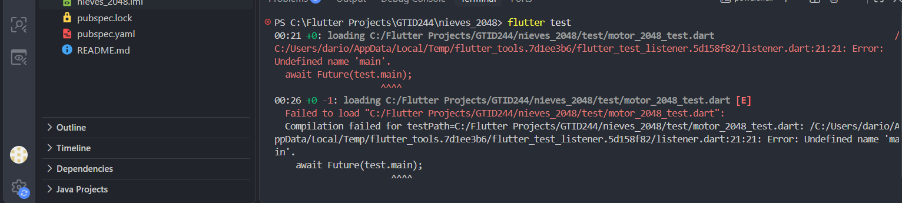
* **🟢 Verde:**
  

---

### Ronda 2 · Fusionar pares adyacentes iguales (`fusionarFila`)
* **🔴 Rojo:**
  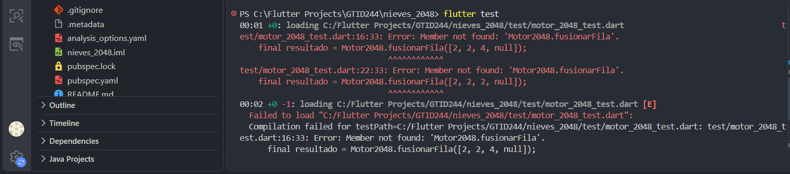
* **🟢 Verde:**
  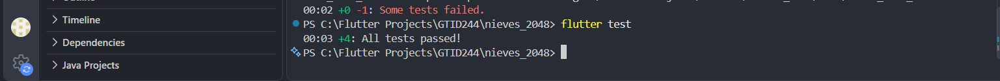

---

### Ronda 3 · Mover una fila completa hacia la izquierda (`moverFilaIzquierda`)
* **🔴 Rojo:**
  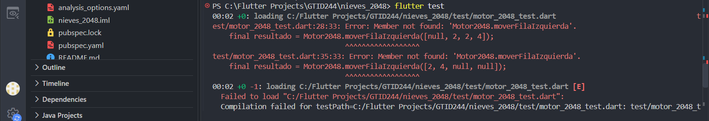
* **🟢 Verde:**
  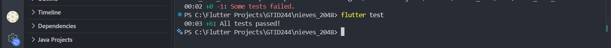

---

### Ronda 4 · Mover la cuadrícula completa hacia la izquierda (`Grid.moverIzquierda`)
* **🔴 Rojo:**
  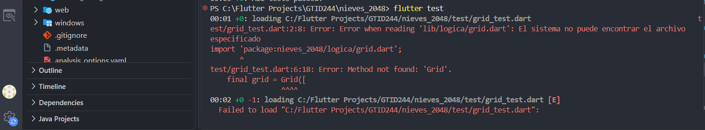
* **🟢 Verde:**
  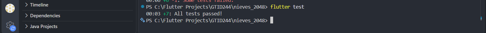

---

### Ronda 5 · Mover hacia la derecha (`Grid.moverDerecha`)
* **🔴 Rojo:**
  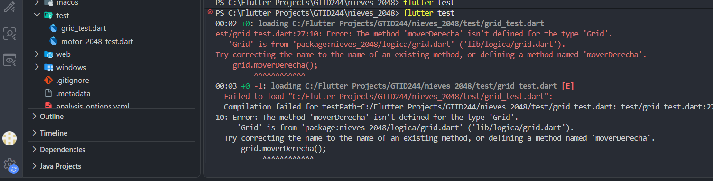
* **🟢 Verde:**
  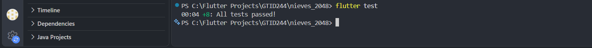

---

### Ronda 6 · Mover arriba y abajo (`moverArriba` y `moverAbajo`)
* **🔴 Rojo:**
  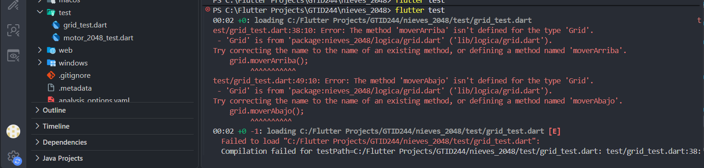
* **🟢 Verde:**
  

---

### Ronda 7 · Agregar una ficha nueva al azar (`agregarFichaAleatoria`)
* **🔴 Rojo:**
  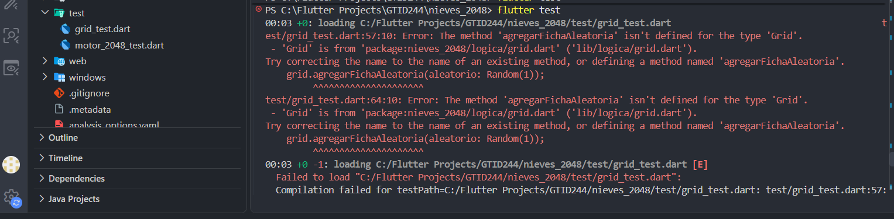
* **🟢 Verde:**
  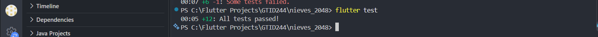

---

### Ronda 8 · Detectar si ya no hay movimientos posibles (`hayMovimientosPosibles`)
* **🔴 Rojo:**
  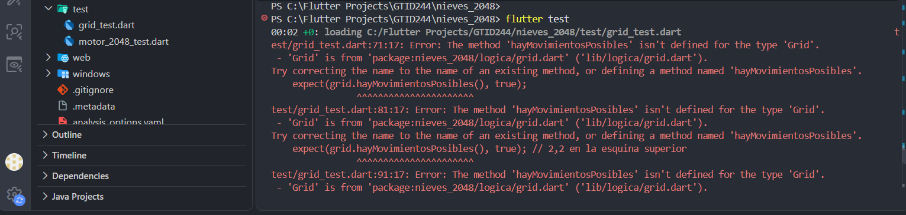
* **🟢 Verde:**
  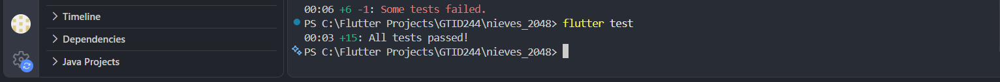

---

### Ronda 9 · Detectar la victoria (`haGanado`)
* **🔴 Rojo:**
  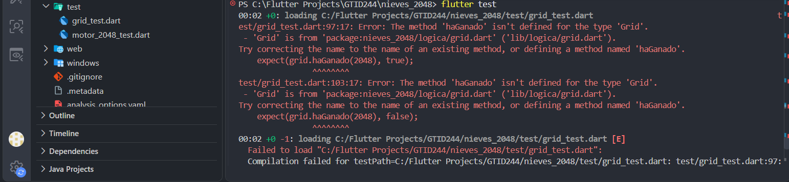
* **🟢 Verde:**
  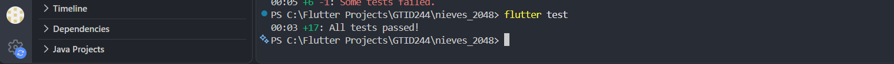

---

### Ronda 10 · Integración en `MotorJuego` (puntaje, turnos, victoria/derrota)
* **🔴 Rojo:**
  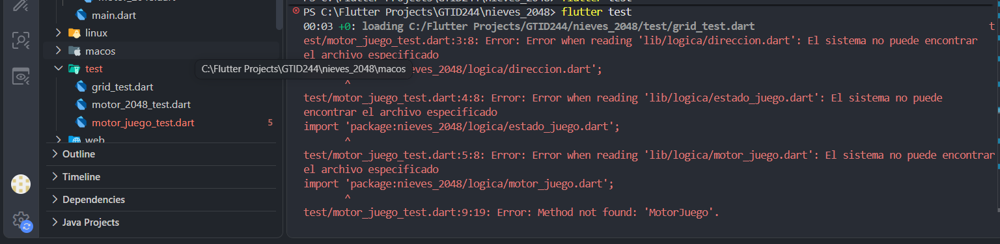
* **🟢 Verde:**
  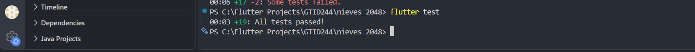

---

### Ejecución de la aplicación (`JuegoScreen`)
* **Aplicación corriendo en dispositivo (fin de partida):**
  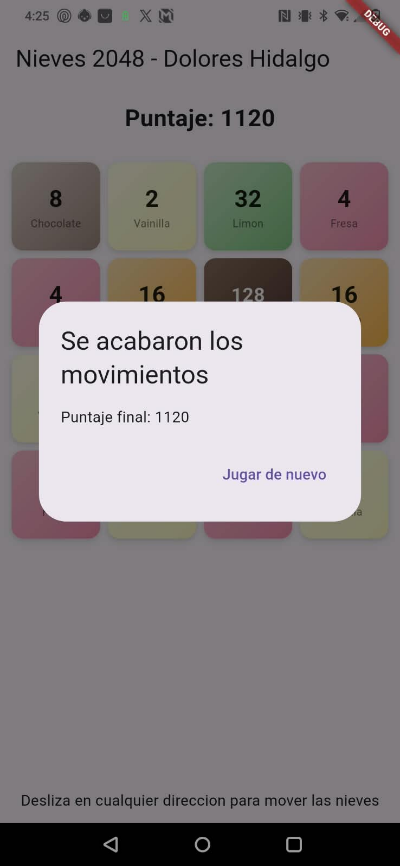
